# Technische Dokumentation und Schritt-für-Schritt Bauanleitung: OpenKNX Busspannungsversorgung 1280 mA (6 TE, redundant, mit Diagnose)

**Projekt:** OpenKNX Bus Power Supply  
**Entwickler / Distribution:** AB-Tools GmbH / [ab-smarthouse.com](https://www.ab-smarthouse.com/produkt/openknx-busspannungsversorgung-1280-ma-6-te-diagnose-redundant/)  
**GitHub / Dokumentation:** [asmcc (GitHub)](https://github.com/asmcc)  
**Firmware-Basis:** OpenKNX `OAM-BusPowerSupply` (GPL-3.0)  
**Hardware-Stände:**
* Basisplatine: `AB-SmartHouse.com Bus Power Supply v1.8`
* Bedieneinheit (Top-Board): `AB-SmartHouse.com Bus Power Supply Top v1.1`
* Transceiver-Modul: `AB-SmartHouse.com NanoBCU v1.1`
* 230V-Netzteiladapter: `AB-SmartHouse.com Bus Power Supply, 230 VAC Adapter v1.1`
* 22–60V DC-Wandler: `AB-SmartHouse.com Bus Power Supply 22-60 VDC Converter v1.3`
* Programmieradapter: `Progger v1.8.1`

---

> [!TIP]
> **Bauanleitung als PDF-Dokument:**
> * 📄 **[Bauanleitung herunterladen (Kompakt / Web, 2,2 MB)](OpenKNX_PowerSupply_Bauanleitung_lq.pdf)** – Ideal zum schnellen Nachschlagen am Bildschirm und Smartphone.
> * 📄 **[Bauanleitung herunterladen (Druckqualität / HQ, 61,7 MB)](https://github.com/asmcc/OpenKNX_AB_PowerSupply/releases)** – Druckreife Version mit unkomprimierten Originalfotos über GitHub Releases.

---

## 1. Systemübersicht & Technische Daten

Die OpenKNX Busspannungsversorgung 1280 mA ist ein hochkompaktes, modulares Reiheneinbaugerät (REG) mit 6 Teilungseinheiten (TE) Baubreite für die Montage auf DIN-Tragschienen (EN 60715). Sie vereint hohe Ausgangsleistung, echte Netzausfallsicherheit durch redundante Netzteileinschübe und detaillierte KNX-Diagnosefunktionen.

### 1.1 Elektrische Kenndaten

| Parameter | Spezifikation | Bemerkung |
| :--- | :--- | :--- |
| **Bussystem** | KNX TP-256 (Twisted Pair) | 9600 Baud |
| **Busausgangsspannung** | Nom. 30 V DC (28–31 V DC) | Gedrosselt |
| **Bus-Nennausgangsstrom** | **1280 mA** Dauerlast | Ausgelegt für große KNX-Linien |
| **Entkopplungsdrossel** | 1,25–1,5 mH (ca. 0,5 $\Omega$ DC) | Ringkerndrossel zur HF-Signalentkopplung |
| **Hilfsspannungsausgang (AUX)** | 30 V DC (ungedrosselt) | Über separate KNX-Klemme (weiß/gelb) |
| **Netzteil-Gesamtleistung** | Bis zu 72 W (30 V / 2,4 A) | Pufferung extremer Busstart- und Einschaltströme |
| **Redundanzkonzept** | 2 Einschübe für autarke Module | Verlustarme Schaltung mit 4 Power-MOSFETs (`D4185`) |
| **Modulkonfiguration 1** | 2x 230 V AC Schaltnetzteile | Speisung über getrennte Phasen / FI-Kreise |
| **Modulkonfiguration 2** | 1x 230 V AC + 1x 22–60 V DC | Notstrom-/Akkupufferung (24 V / 48 V Akku, USV oder PV) |
| **Modulkonfiguration 3** | 2x 22–60 V DC Wandler | Reine DC-Infrastruktur / Kleinspannungsverteilung |
| **Controller-Plattform** | Raspberry Pi RP2040 | Dual-Core ARM Cortex-M0+ @ 133 MHz, 16 MB SPI-Flash |
| **KNX-Transceiver** | ON Semiconductor NCN5130 | Integrierter Bit-Transceiver mit Analog-Frontend auf NanoBCU |
| **Gehäuse** | 6 TE Hutschienengehäuse (REG) | Modulares 3D-Druck-Gehäuse mit verschraubter Frontblende |

### 1.2 Sicherheits- und Haftungshinweis

> [!WARNING]
> **Netzspannung 230 V AC:** Bei Arbeiten an 230-V-Netzspannung besteht Lebensgefahr durch elektrischen Schlag. Montage und Anschluss dürfen nur durch eine ausgebildete Elektrofachkraft unter Beachtung der geltenden VDE-Vorschriften (DIN VDE 0100) erfolgen.
> 
> **Maker-/DIY-Projekt:** Es handelt sich um ein quelloffenes Gemeinschaftsprojekt für Selbstbauer. Das Gerät besitzt keine Baumusterprüfung und keine offizielle KNX-Verbandszertifizierung. Der Zusammenbau und Einsatz in elektrischen Anlagen erfolgt eigenverantwortlich auf eigene Gefahr.

---

## 2. Schritt-für-Schritt-Bauanleitung

Die nachfolgende Bauanleitung gliedert sich exakt nach den Bauabschnitten und Arbeitsschritten der Fotodokumentation.

---

### Übersicht & Komponenten

Vor Montagebeginn sind alle Teile auf Vollständigkeit und mechanische Unversehrtheit zu prüfen.

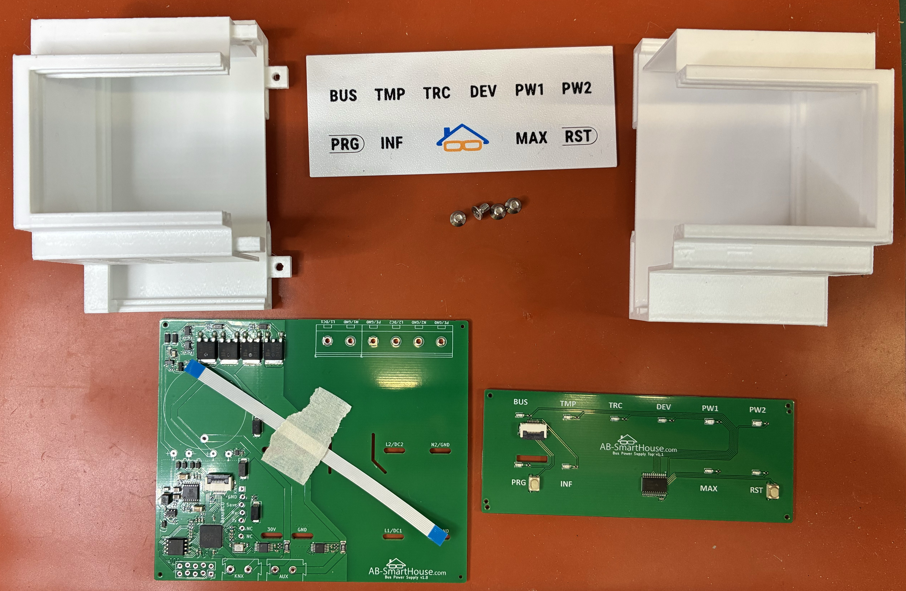

#### Mechanische Teile:
* 3D-Druck-Hutschienengehäuse 6 TE (2 Gehäusehälften: Unterschale mit Rasthaken für DIN-Schiene, Oberschale mit Lüftungsschlitzen).
* Frontblende aus UV-stabilem Kunststoff mit LED- und Tastenbeschriftung sowie Firmenlogo.
* 4x M3 Senkkopf-Inbusschrauben zur Fixierung der Frontblende.

#### Elektronische Baugruppen & THT-Bauteile:
* Hauptplatine `AB-SmartHouse.com Bus Power Supply v1.8` (Base Board mit SMD vorbestückt).
* Bedienerplatine `AB-SmartHouse.com Bus Power Supply Top v1.1`.
* FFC-Flachbandkabel (15-polig, ca. 10 cm, mit blauen Versteifungslaschen).

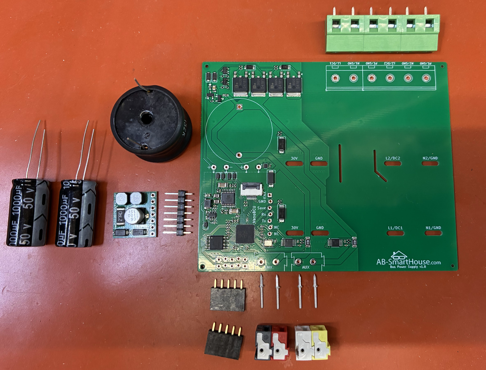

* 1x Ringkerndrossel (1,25–1,5 mH / ca. 0,5 $\Omega$, Typ `152K`).
* 2x Elektrolytkondensatoren 1000 µF / 50 V (105 °C, Low-ESR).
* 1x KNX-Transceiver-Daughterboard `NanoBCU v1.1` mit 1x7 Stiftleiste.
* 1x 6-polige steckbare Schraubklemmenleiste (drei 2-polige Blöcke, grün).
* 2x 1x5 Buchsenleisten (für 2x5 Progger-Schnittstelle).
* 4x KNX-Anschlussstifte (für Standard-Busklemmen).
* 1x KNX-Busklemme Standard (rot/schwarz) für KNX TP.
* 1x KNX-Hilfsspannungsklemme (weiß/gelb) für ungedrosselte 30 V AUX.

---

### Vorbereitung AC/DC-Netzteil 230 V AC

Das primäre 230-V-AC-Schaltnetzteil (30 V / 72 W) wird über eine Zwischenadapterplatine (`Bus Power Supply, 230 VAC Adapter v1.1`) vertikal auf die Basisplatine geführt.

| Netzteil und Adapterplatine | Modul-Unterseite |
| :---: | :---: |
| 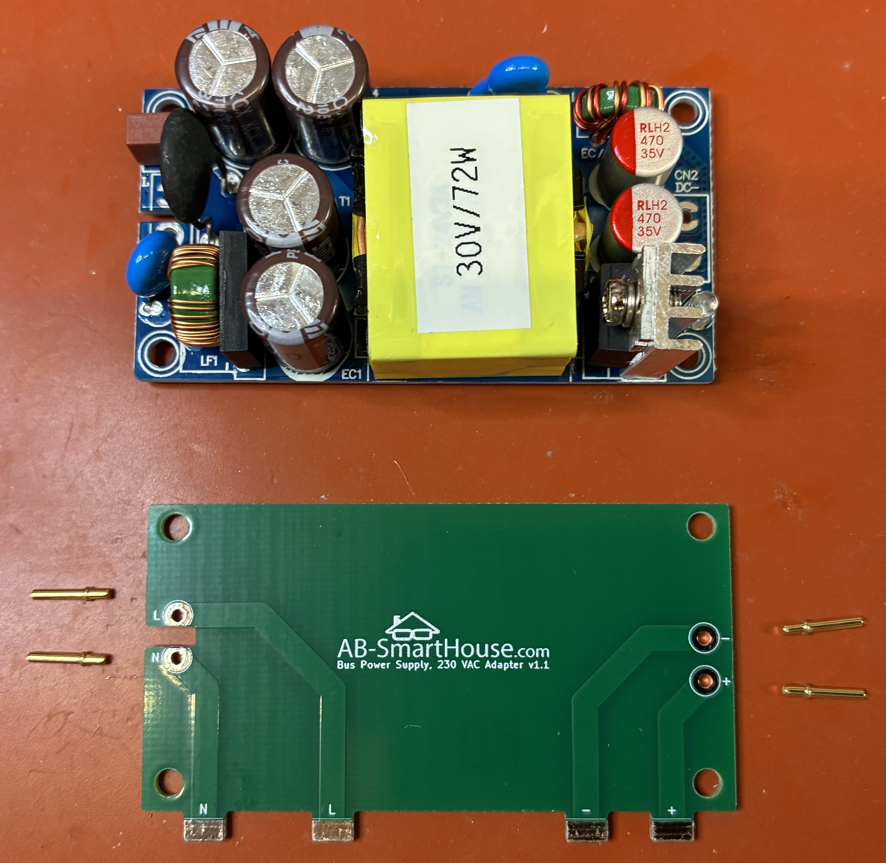 | 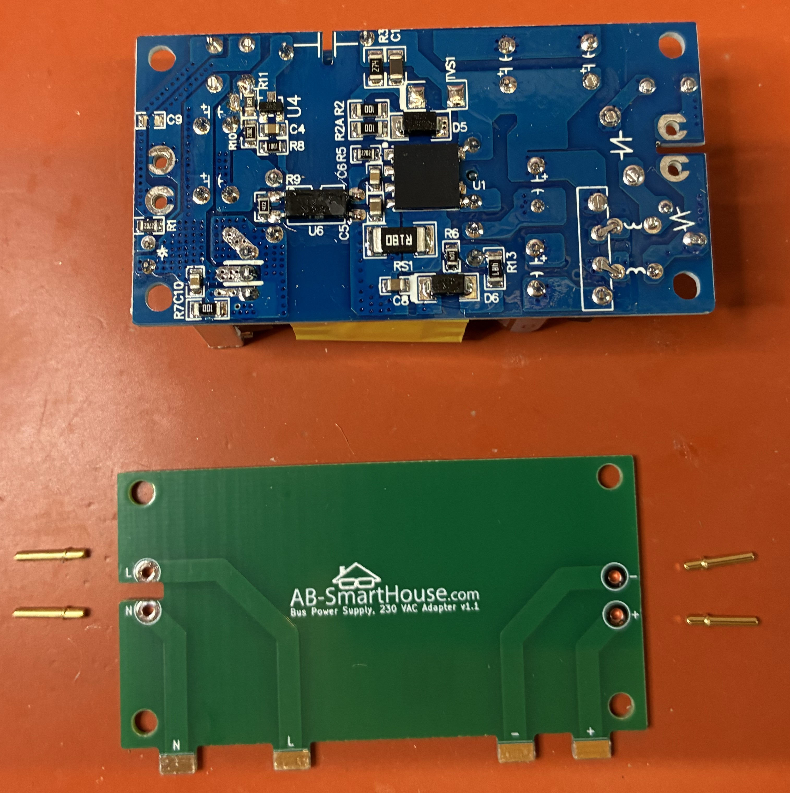 |

#### Montage der Lötstifte & Adapterplatine:
1. **Lötstifte einsetzen:** Zur mechanischen Kopplung und elektrischen Verbindung dienen 4 massive Kontaktstifte (Lötstifte). Diese werden primärseitig (L, N) und sekundärseitig (+, –) von der Unterseite der Adapterplatine eingesteckt und verlötet.
2. **Platinen zusammenfügen:** Anschließend wird das Schaltnetzteil aufgesetzt. Es gibt hier keinen separaten Abstandshalter! Die beiden Platinen müssen möglichst nah aneinander zusammengedrückt werden, sodass die SMD-Bauteile des AC/DC-Netzteils direkt an der Hilfsplatine anliegen und der verbleibende Abstand zwischen den beiden Platinen lediglich **2–3 mm** beträgt (siehe Abbildungen).
3. **Durchlöten:** Die Lötstifte werden nun von beiden Seiten mit ausreichend Hitze (350–380 °C) und Lötzinn voll durchgelötet.

| Lötstifte in Adapterplatine eingesetzt | Lötstifte auf Rückseite verlötet |
| :---: | :---: |
| 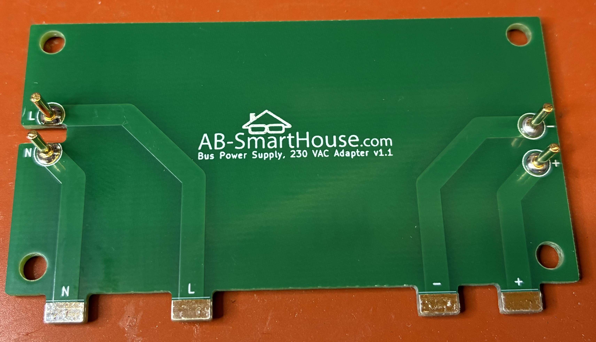 | 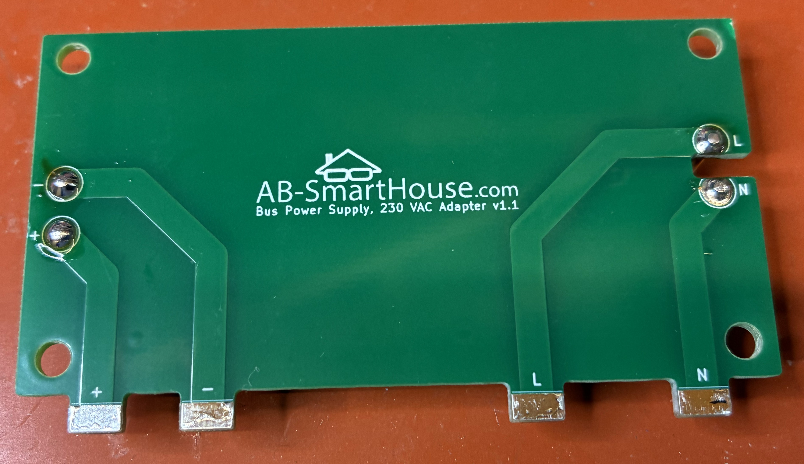 |

| Zusammenfügen Primärseite (2–3 mm Abstand) | Zusammenfügen Sekundärseite |
| :---: | :---: |
| 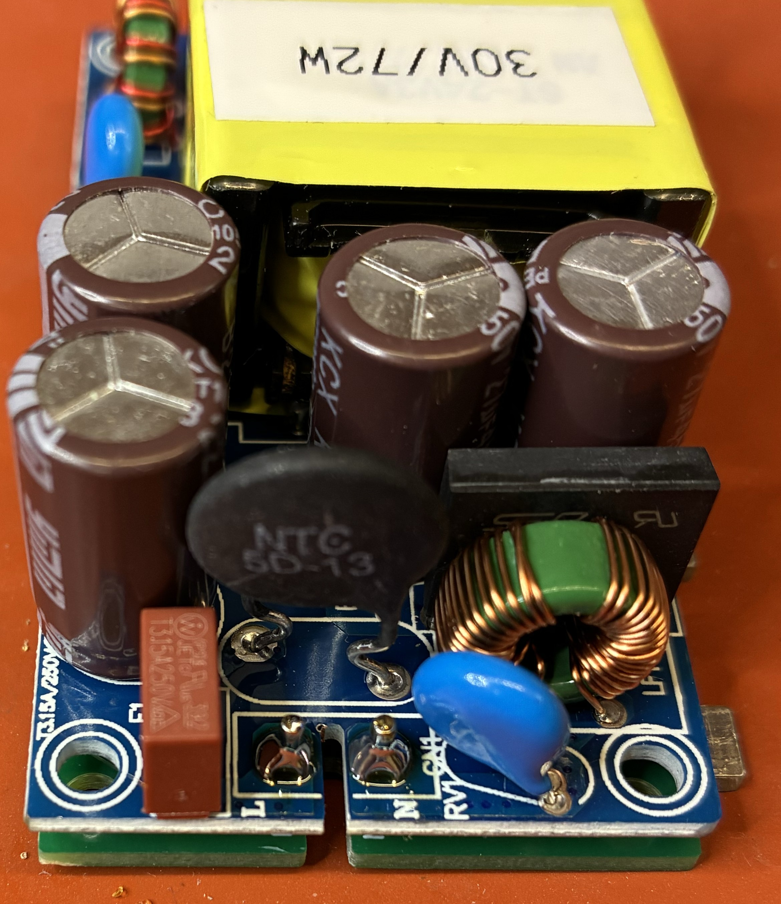 | 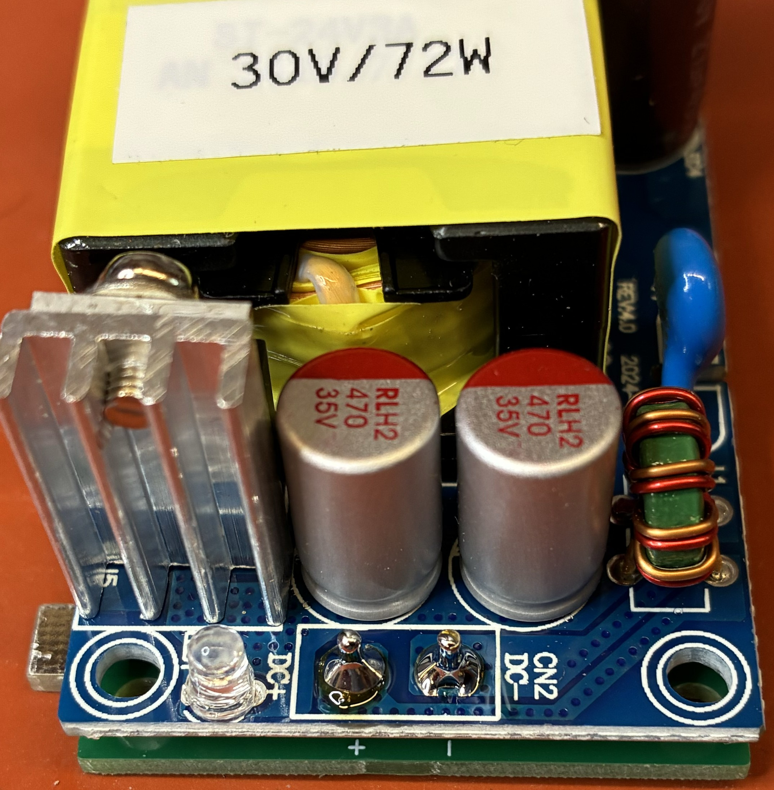 |

| Fertig verlötete Sekundärseite | Fertig verlötete Primärseite |
| :---: | :---: |
| 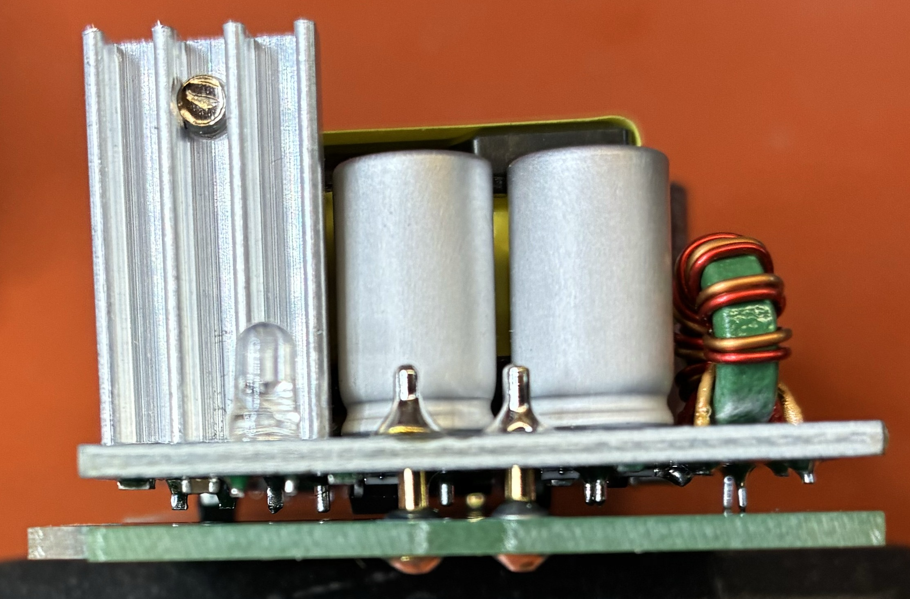 | 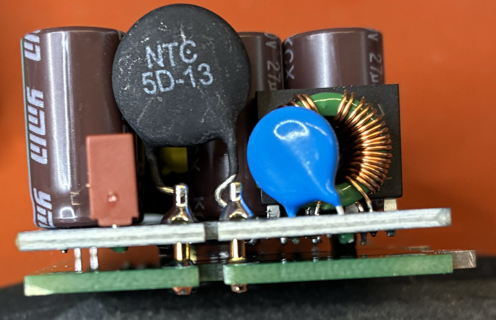 |

> [!IMPORTANT]
> Auf ausreichenden Zinnfluss an den Hochstrom- und Hochspannungspins achten. Durch das saubere Zusammendrücken auf 2–3 mm Abstand ist die mechanische Stabilität und die Einhaltung der Gehäuse-Einbauhöhe gewährleistet.

---

### Vorbereitung DC/DC-Wandler 22–60 V DC

Das DC/DC-Wandlermodul `Bus Power Supply 22-60 VDC Converter v1.3` dient der sekundären Speisung aus Batteriespeichern (24 V oder 48 V Akku) oder USV-Anlagen. Da dieses Modul neu im Fertigungsprogramm ist, bedarf es einer besonders sorgfältigen mechanischen Vorbereitung vor dem Einlöten.

| Vorderseite DC/DC-Modul vor Bearbeitung | Rückseite vor Bearbeitung |
| :---: | :---: |
| 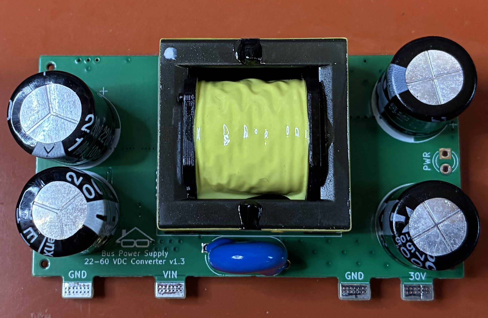 | 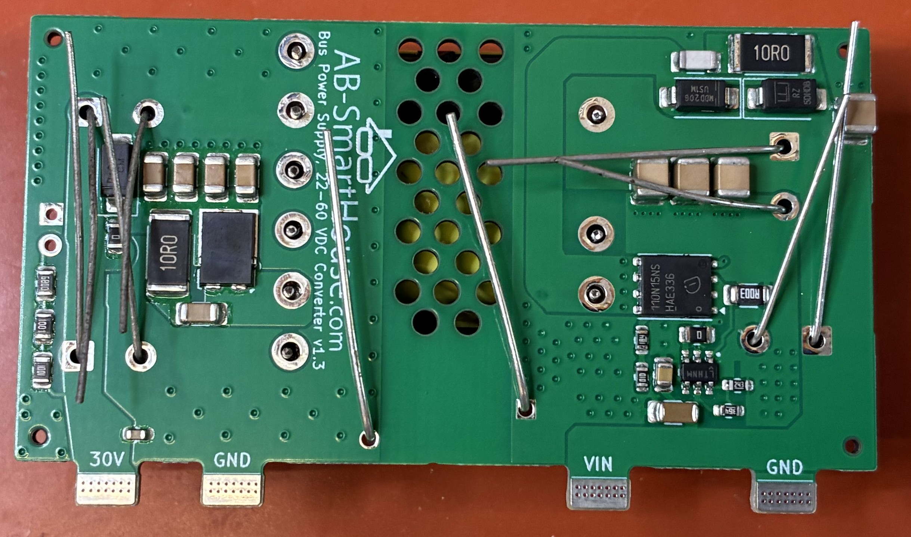 |

#### Detaillierte Arbeitsschritte:
1. **Drahtüberstände identifizieren:** Auf der Rückseite der Platine stehen werkseitig mehrere bedrahtete THT-Bauteile weit hervor:
   * Die massiven Beinchen des Schaltübertragers/Transformators,
   * Die Anschlussdrähte der Elektrolytkondensatoren,
   * Die Anschlüsse des blauen Y-Entstörkondensators.
2. **Bündiges Abtrennen:** Mit einem scharfen Präzisions-Seitenschneider (ohne Wate) müssen sämtliche überstehenden Drähte direkt an der Platine bündig abgezwickt werden.
3. **Profil- und Höhenprüfung:** In der Seitenansicht prüfen, dass die Bauteilhöhe auf der Platinenrückseite plan ist und unter **1 mm** bleibt. Dies ist zwingend erforderlich, um bei der späteren vertikalen Montage Kurzschlüsse mit der Basisplatine oder den Leiterbahnen zu verhindern.
4. **Sauberes Verlöten:** Alle Bauteile ordentlich und ohne Überreste vom Lötzinn verlöten. Es dürfen keine spitzen Zinnhütchen oder Lotperlen stehen bleiben.
5. **Grüne Grundlast-LED einlöten:** 
   * Die grüne 3-mm-Bedrahtungs-LED wird auf der Oberseite des Moduls am Bestückungsplatz `PWR` eingesetzt (Polarität beachten: langes Beinchen = Anode / `+`, kurzes Beinchen = Kathode / `–`).
   * Die LED auf der Unterseite verlöten und die überstehenden Anschlussbeine ebenfalls bündig mit dem Seitenschneider abtrennen.

> [!NOTE]
> **Funktion der grünen LED (Grundlast):**  
> Die grüne LED erfüllt eine wichtige schaltungstechnische Schutzfunktion: Sie dient als Grundlast für das Schaltnetzteil. Im lastfreien Leerlauf begrenzt sie die Ausgangsspannung zuverlässig auf maximal **31,5 V DC**. Ohne diese definierte LED-Grundlast kann die Ausgangsspannung des Schaltreglers im Leerlauf auf bis zu **40 V DC** ansteigen und nachgeschaltete Komponenten schädigen!

| Kürzen der Bauteilbeinchen mit Seitenschneider | Profilprüfung: Höhe unter 1 mm |
| :---: | :---: |
| 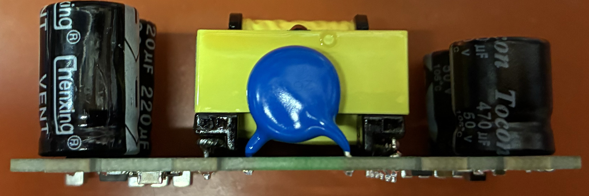 | 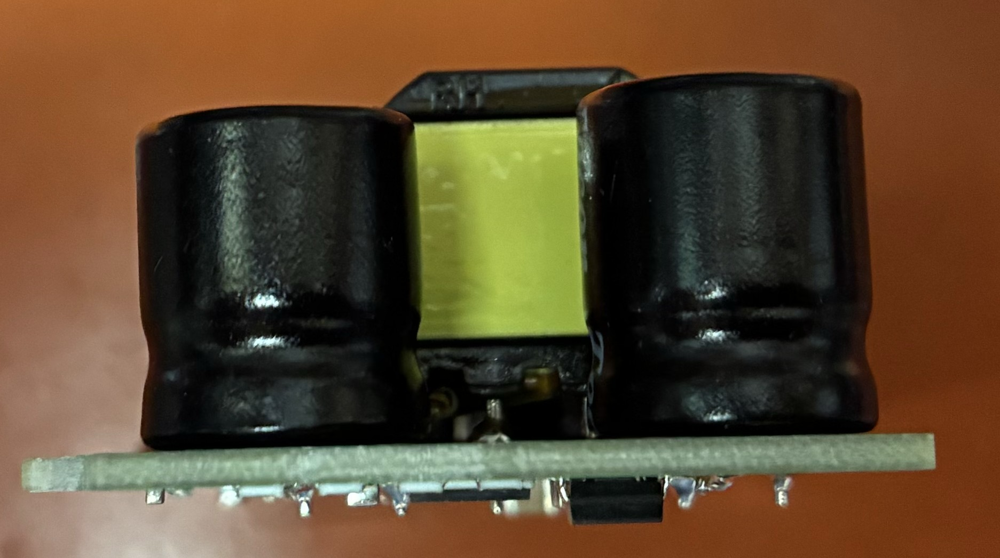 |

| Moduloberseite mit bestückter grüner LED (PWR) | Seitenansicht der bestückten LED |
| :---: | :---: |
| 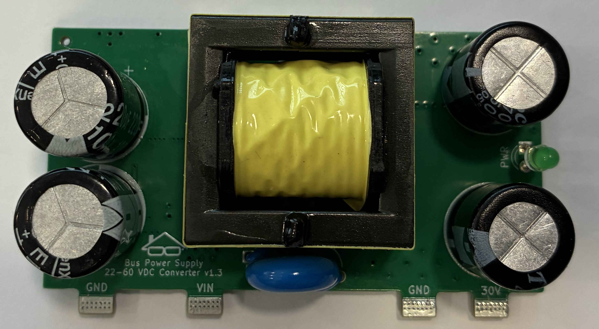 | 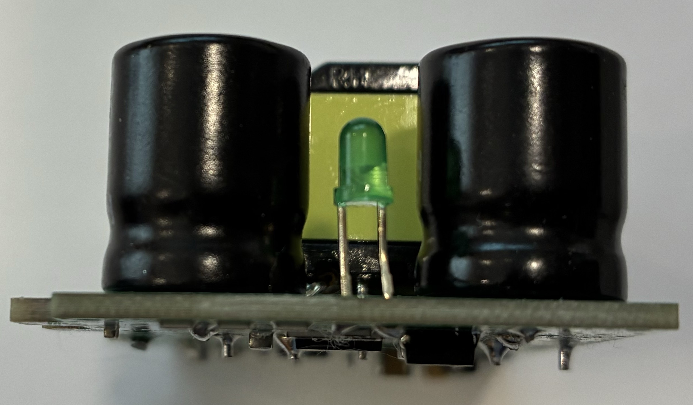 |

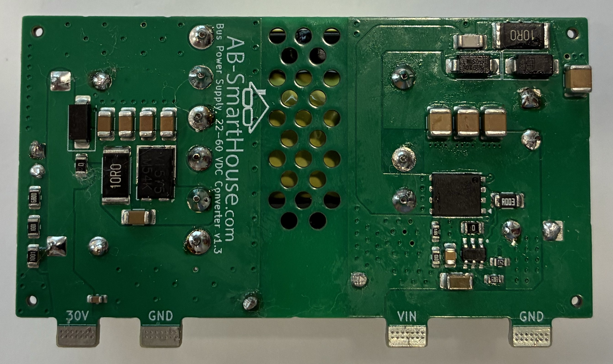

---

### Steckerleisten & Schraubanschlüsse

Auf der Basisplatine werden nun die Schraubklemmen für die Spannungszuleitungen sowie die Buchsenleisten für den Programmieradapter und die NanoBCU bestückt.

| 6-poliger Schraubklemmenblock | Unterseite Verlötung der Schraubklemmen |
| :---: | :---: |
| 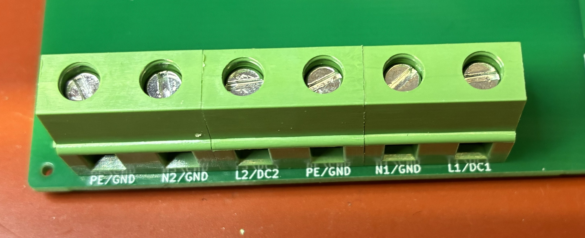 | 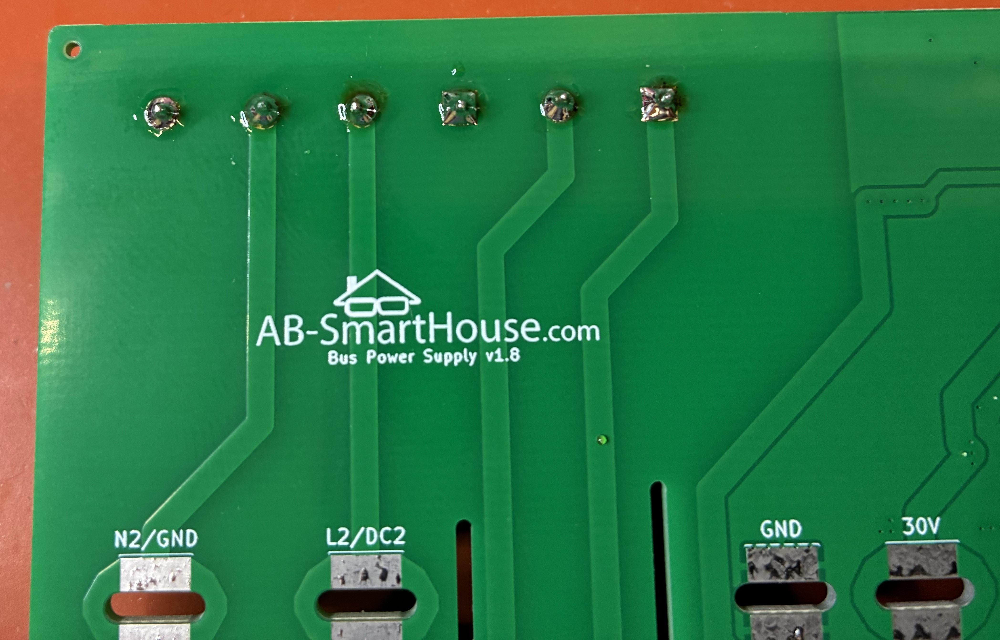 |

#### Arbeitsschritte:
1. **6-poligen Schraubklemmenblock vorbereiten & einlöten:** 
   * Die Klemme besteht aus drei separaten 2-poligen Klemmenblöcken.
   * **Mechanische Verbindung:** Die drei 2-poligen Blöcke vorab über die seitlichen Schwalbenschwanz-Führungen fest ineinander einstecken und somit mechanisch einen stabilen 6-poligen Gesamtblock bilden.
   * Den Block so auf die Basisplatine setzen, dass die Drahteinführungen nach außen zur Gehäusekante zeigen und die Klemmschrauben von oben zugänglich sind.
   * Klemmenbelegung (von links nach rechts): `PE/GND` | `N2/GND` | `L2/DC2` | `PE/GND` | `N1/GND` | `L1/DC1`.
2. **Progger-Buchsenleiste einlöten:** 
   * Zwei 1x5-polige schwarze Buchsenleisten nebeneinander zu einer 2x5-Pfostenbuchse auf der linken unteren Platinenseite einlöten.
3. **Stiftleiste für NanoBCU:** 
   * Eine 1x7-polige Stiftleiste (Raster 2,54 mm) senkrecht im markierten Bereich `NanoBCU` einsetzen und verlöten.

| Unterseite Lötstellen Progger und NanoBCU | Bestückte Oberseite mit NanoBCU- und Progger-Leiste |
| :---: | :---: |
| 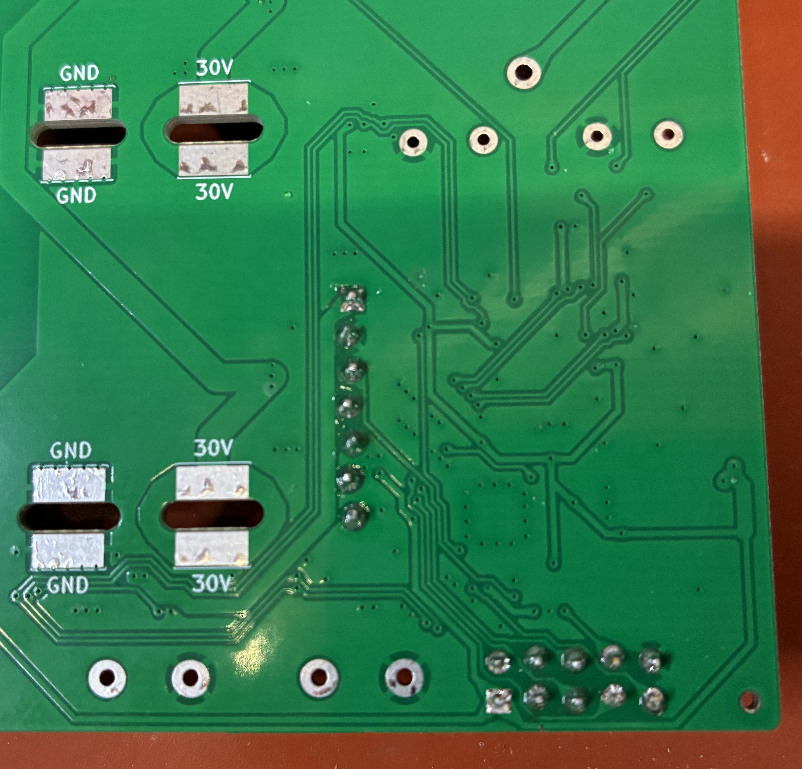 | 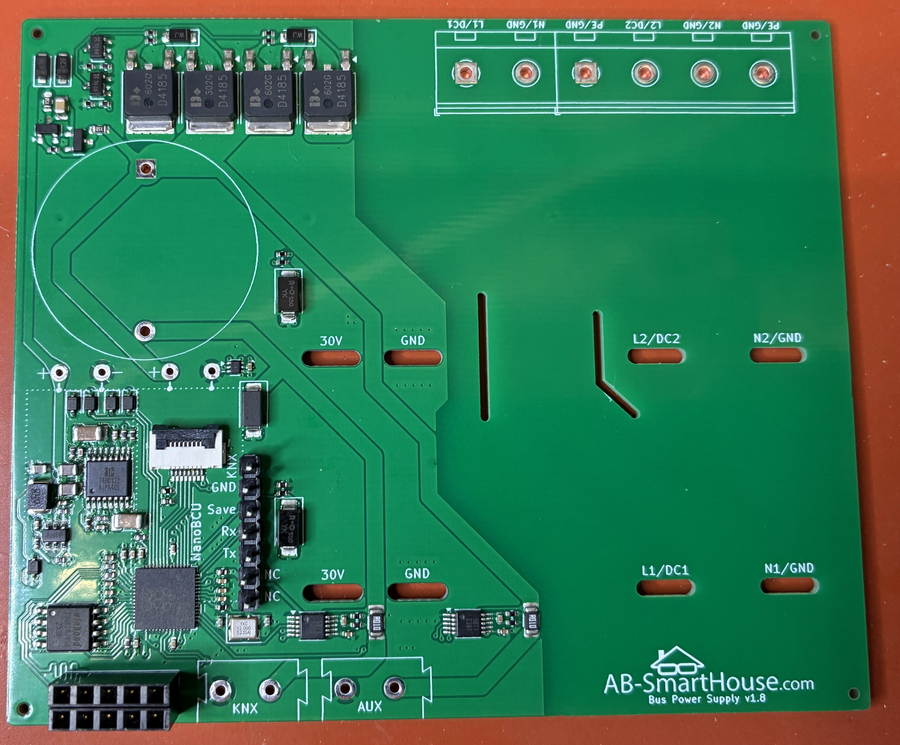 |

---

### KNX-Modul (NanoBCU)

Das Daughterboard `NanoBCU v1.1` beinhaltet das analoge Frontend und den zertifizierten KNX-Transceiver **ON Semiconductor NCN5130**.

| NanoBCU mit Isolierfolie um Elektrolytkondensator | Huckepack-Montage Seitenansicht |
| :---: | :---: |
| 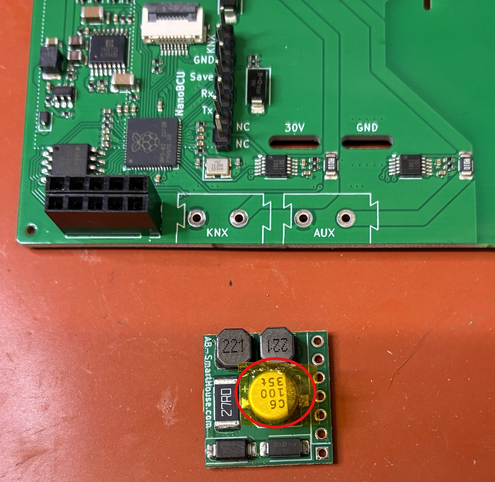 | 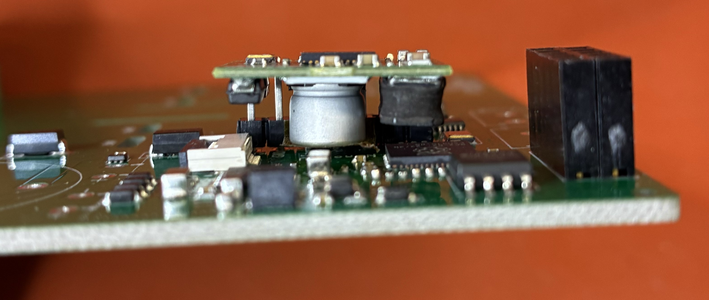 |

#### Arbeitsschritte:
1. **Isolationsschutz auf Elektrolytkondensator prüfen / anbringen:**
   * Der auf der NanoBCU sitzende Elektrolytkondensator (100 µF / 35 V) muss mit einer hitzebeständigen Isolierfolie (Kaptonband) sauber abgeklebt werden (in der Abbildung mit rotem Kreis hervorgehoben).
   * **Wichtiger Hinweis:** Diese Isolierung verhindert zuverlässig eventuelle Kurzschlüsse mit darüberliegenden Leiterbahnen oder den Bauteilen der später montierten großen Elkos.
2. **Aufstecken & Verlöten:**
   * Das Modul auf die 1x7-Stiftleiste oberhalb des RP2040 aufstecken.
   * Signalkontakte: Kontaktiert werden die oberen 5 Pins: `KNX`, `GND`, `SAV` (Save-Signal für Stromausfall-Erkennung), `RX`, `TX`. Die unteren Pins `3V3` / `NC` bleiben unbeschaltet.
   * Das Modul waagerecht ausrichten, sodass der Elko frei über den Bauteilen der Hauptplatine liegt, und an der Stiftleiste verlöten.

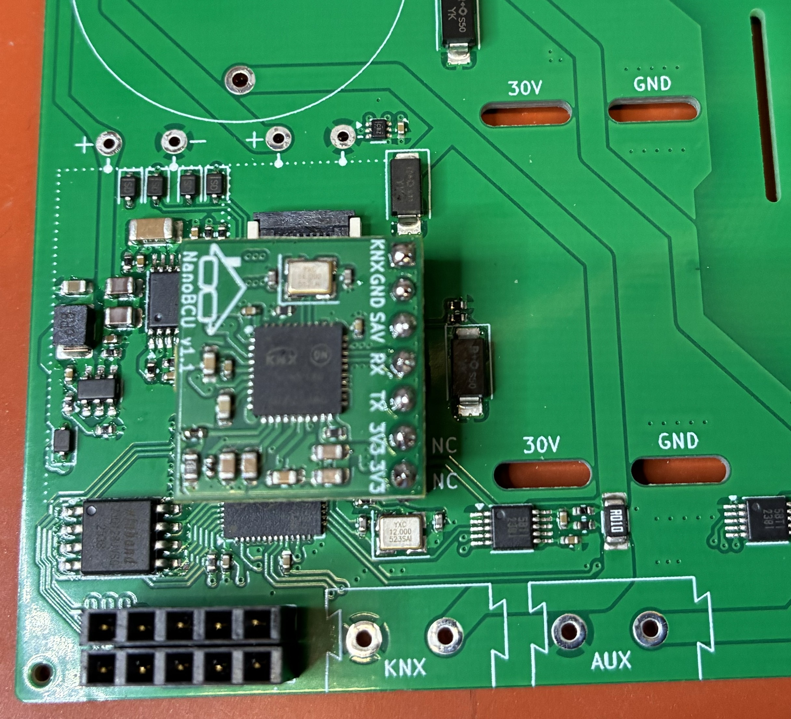

---

### KNX- & Hilfsspannungsanschlüsse (AUX)

Zur Einspeisung in den KNX-Bus und zur Bereitstellung der ungedrosselten 30-V-Hilfsspannung werden nun die genormten KNX-Pins bestückt.

| Lötseite KNX-Anschlusspins | Aufgesteckte KNX- und AUX-Klemmen |
| :---: | :---: |
| 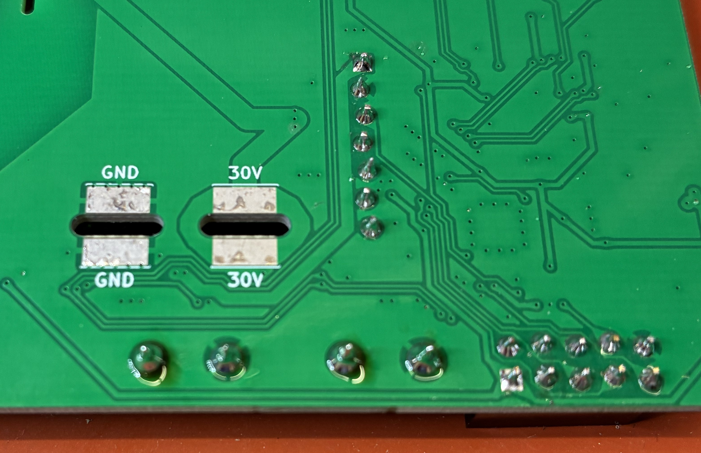 | 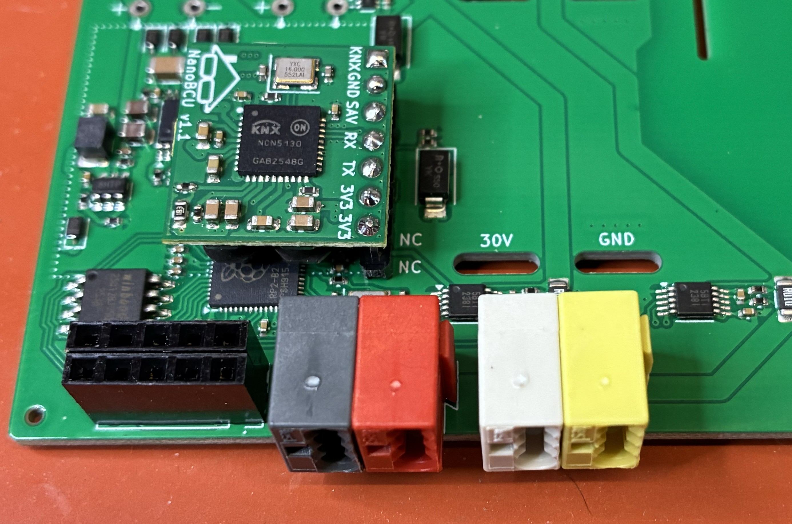 |

#### Arbeitsschritte:
1. 4 vergoldete Anschlussrundstifte in die vorgesehenen Bohrungen für `KNX` und `AUX` einstecken.
2. Rechtwinklig zur Platine ausrichten und auf der Unterseite vollflächig verlöten.
3. Aufstecken der Busklemmen:
   * **KNX Bus:** Rot/Schwarz (Rot = Bus +, Schwarz = Bus –).
   * **AUX Hilfsspannung:** Weiß/Gelb (Gelb = AUX +, Weiß = AUX –).

---

### KNX-Entkopplungsdrossel

Die Drosselspule verhindert, dass die hochfrequenten modulierten KNX-Telegramme (Wechselspannungsanteil) durch die niedrige Ausgangsimpedanz des Schaltnetzteils kurzgeschlossen werden.

| Unterseite mit durchgesteckten Drähten | Bündig abgetrennte und nachgelötete Drähte |
| :---: | :---: |
| 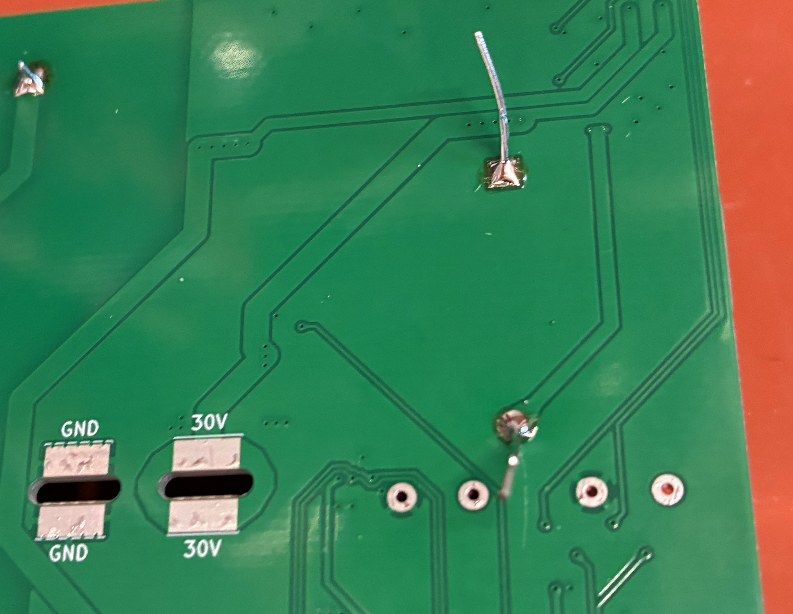 | 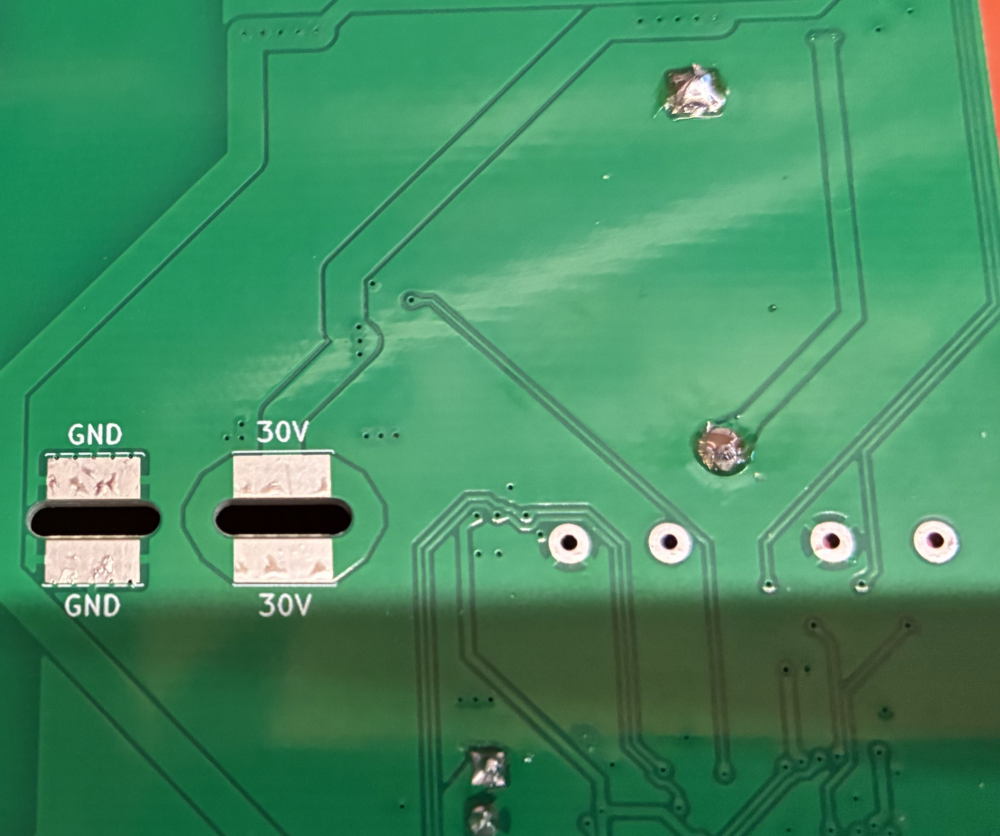 |

#### Arbeitsschritte:
1. Die Ringkerndrossel (Kennzeichnung `152K`, ca. 1,25–1,5 mH) plan auf die Oberseite der Platine aufsetzen.
2. Die massiven Kupferlackdrähte straff durch die Bohrungen führen und auf der Platinenunterseite großflächig verlöten.
3. **Drähte bündig abtrennen:** Die überstehenden massiven Drahtenden mit dem Seitenschneider bündig abtrennen und sauber nachlöten, sodass keine scharfen Überstände verbleiben.
4. **FFC-Flachbandkabel montieren:** Das weiße 15-polige FFC-Kabel mit der blauen Versteifung nach oben in die ZIF-Buchse der Basisplatine einschieben und den schwarzen Schieberiegel fest verriegeln.

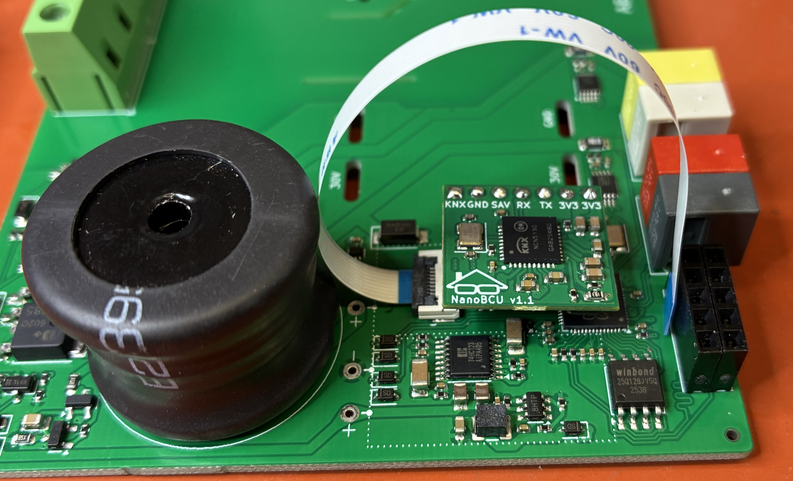

---

### Elektrolytkondensatoren

Aufgrund der genormten Bauhöhe im REG-Gehäuse (6 TE) können die beiden großen 1000 µF / 50 V Glättungskondensatoren nicht stehend verbaut werden.

| Vorbereitung der Elkos 1000 µF / 50 V | FFC-Kabelführung: unter den Elkos / über NanoBCU |
| :---: | :---: |
| 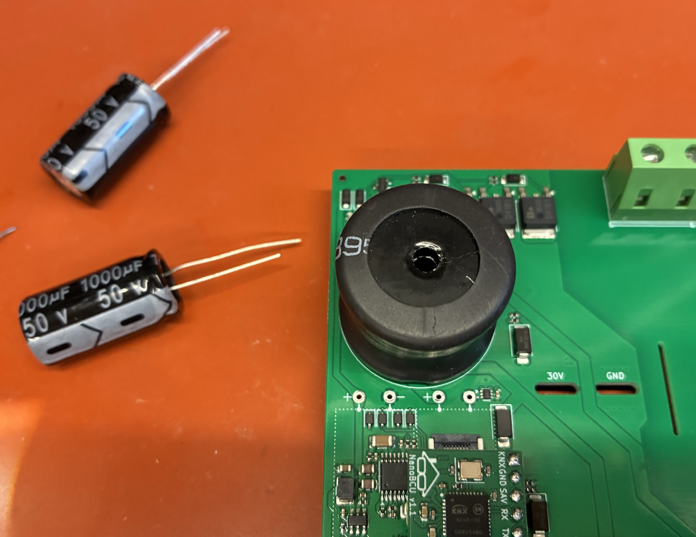 | 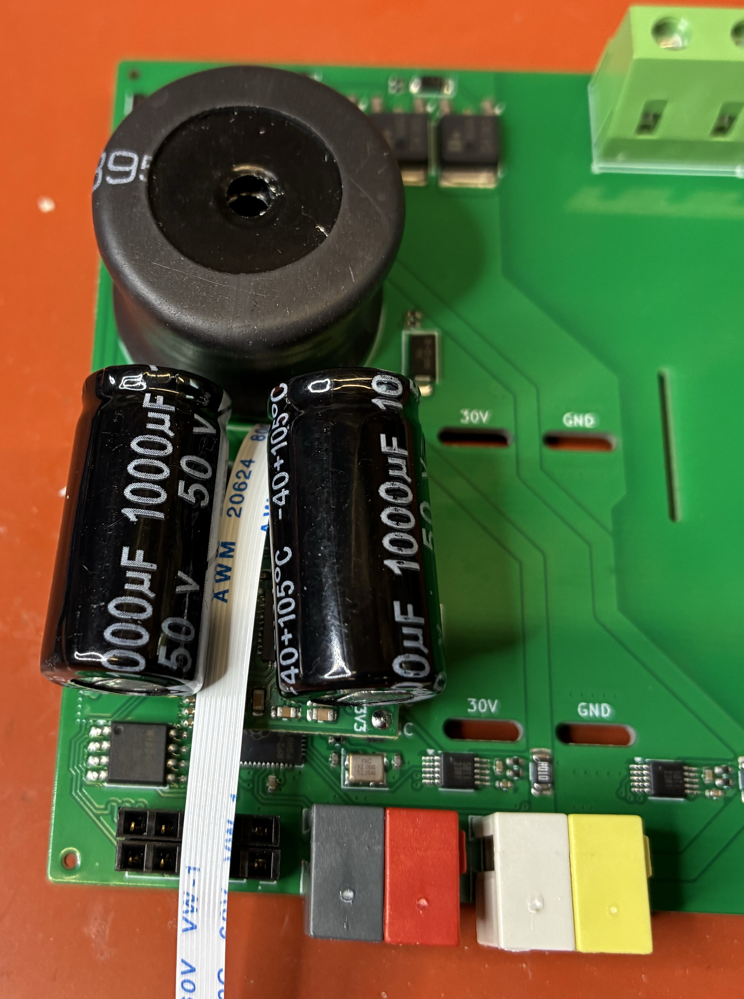 |

#### Montageanweisung:
1. Die Anschlussbeine der beiden Elkos im Abstand von ca. 3 mm vom Becherboden präzise um **90° abwinkeln**.
2. **Polarität strikt beachten:** Die Minus-Markierung (weißer Streifen mit Minuszeichen) muss exakt mit dem Aufdruck auf der Leiterplatte übereinstimmen.
3. Die Elkos so einlöten, dass sie waagerecht direkt oberhalb des NanoBCU-Transceiver-Moduls liegen.
4. **FFC-Kabelführung:** Das weiße FFC-Flachbandkabel muss vor dem endgültigen Verlöten der Elkos sauber **unter den liegenden Elkos und oberhalb der NanoBCU** eingefädelt werden.

| Seitenansicht der liegenden Elkos | Fertig verlötete Elko-Baugruppe |
| :---: | :---: |
| 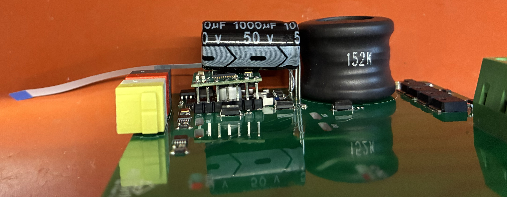 | 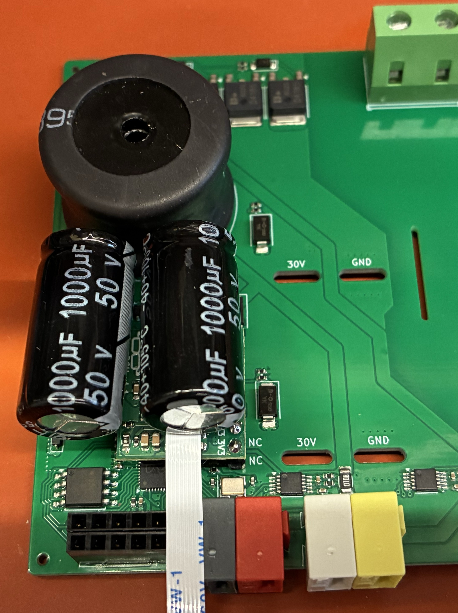 |

---

### Montage der Netzteilmodule (AC/DC & DC/DC)

Nun werden die vorbereiteten Leistungswandler vertikal in die Basisplatine eingelötet.

| Kapton-Isolierband (Pfeil) | Kühlkörper über Kapton-Schutzstreifen (Pfeil) |
| :---: | :---: |
| 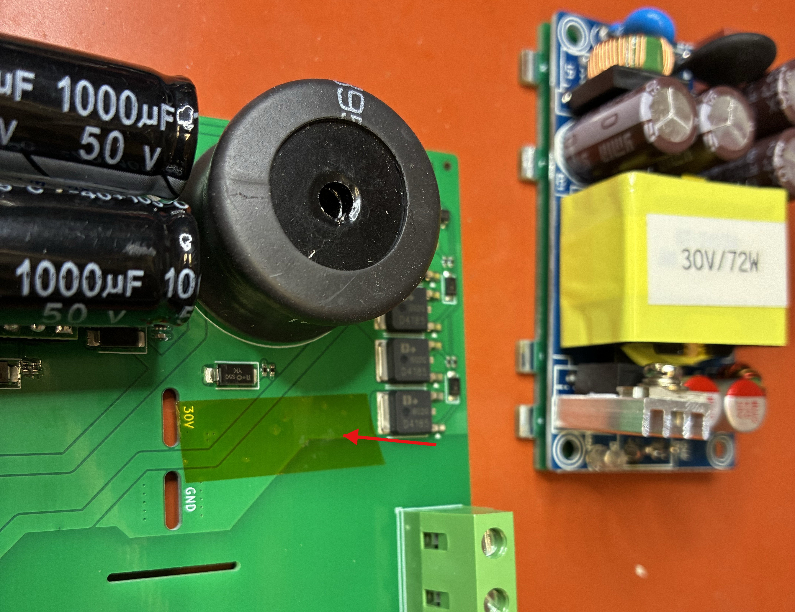 | 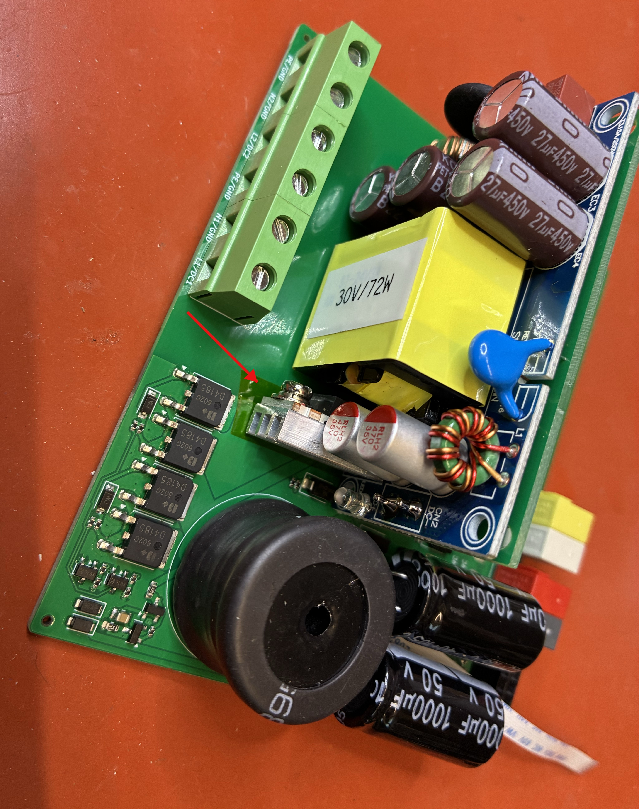 |

#### Arbeitsschritte:
1. **Isolationsschutz aufbringen (Kapton-Band):** 
   * Auf die Oberseite der Basisplatine wird im Bereich unterhalb des sekundärseitigen Kühlkörpers des AC/DC-Netzteils ein Streifen **Kapton-Band (Polyimid-Hochtemperaturklebeband)** aufgeklebt (in den Abbildungen durch rote Pfeile gekennzeichnet).
   * Dies verhindert Berührungen oder Kurzschlüsse zwischen Kühlkörper/Befestigungsschraube und den Leiterbahnen bzw. den 4 Power-MOSFETs (`D4185`).
2. **AC/DC-Modul einsetzen & verlöten (Hintere Reihe):**
   * Das 230-V-AC-Modul in die hinteren Montageschlitze einsetzen.
   * Die Lötflächen auf der Oberseite sowie die breiten Anschlussflächen auf der Platinenunterseite mit ausreichend Hitze (350–380 °C) und Zinn vollflächig verlöten.
3. **DC/DC-Modul einsetzen & verlöten (Vordere Reihe):**
   * Das 22–60-V-DC-Wandlermodul (bzw. das optionale zweite AC/DC-Modul) in die vorderen Schlitze stecken und ebenfalls beidseitig massiv verlöten.
4. **Prüfung der Lötstellen auf der Unterseite:**
   * Auf der Platinenunterseite kontrollieren, dass alle Hochstrom-Schlitzverbindungen vollständig mit Lot ausgefüllt sind.

| Hinteres AC/DC-Modul vertikal montiert | Unterseite: Lötstellen des hinteren Moduls |
| :---: | :---: |
| 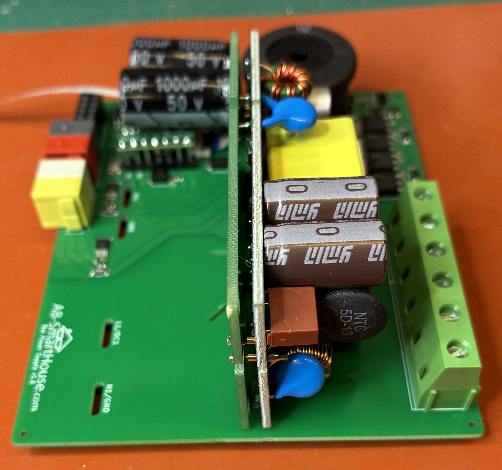 | 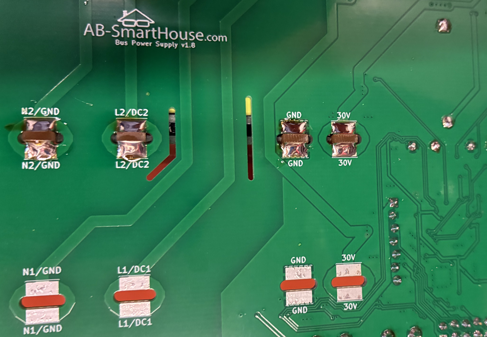 |

| Beide Module vertikal verlötet | Unterseite: Durchgelötete Anschlussflächen beider Module |
| :---: | :---: |
| 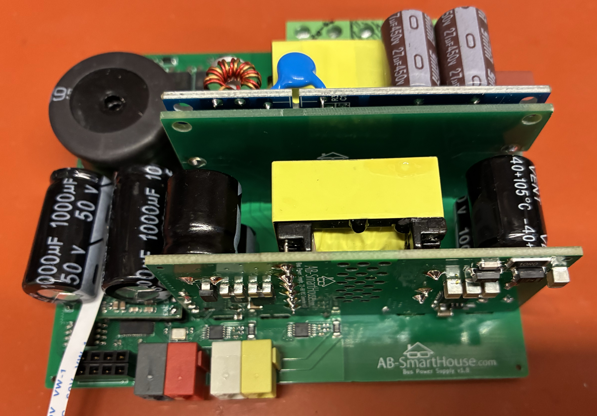 | 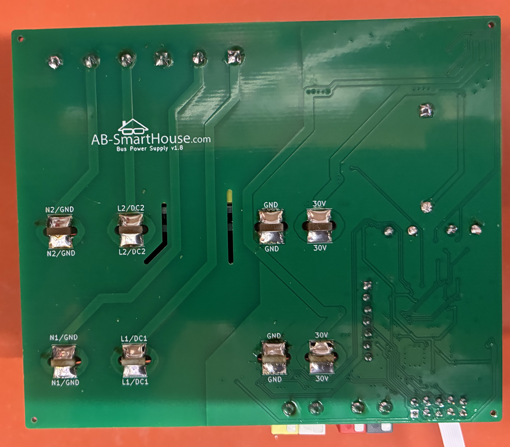 |

| Gesamtansicht montierter Leistungsblock | Profilansicht: Gesamthöhe und Einbaumaße |
| :---: | :---: |
| 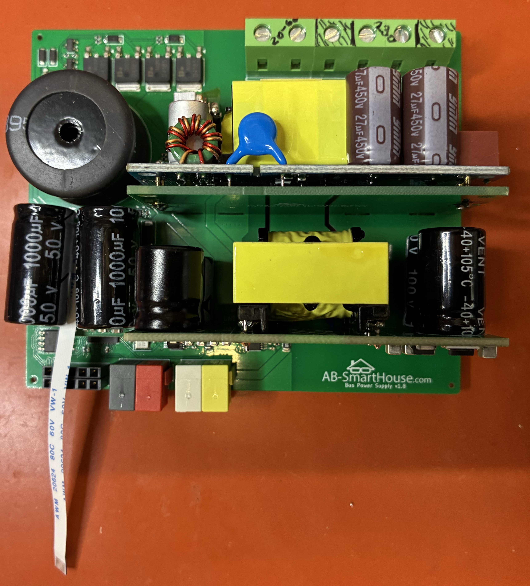 | 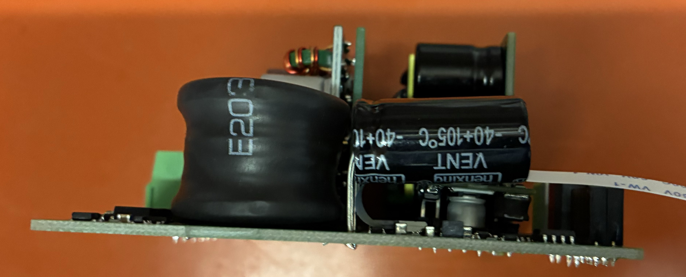 |

---

### Bediener-Einheit & Progger

Das Top-Board `Bus Power Supply Top v1.1` trägt die 8 Diagnose-LEDs, die Bedientaster und die Ansteuerungslogik.

| Bedienerplatine montiert | Aufgesteckter Progger v1.8.1 |
| :---: | :---: |
| 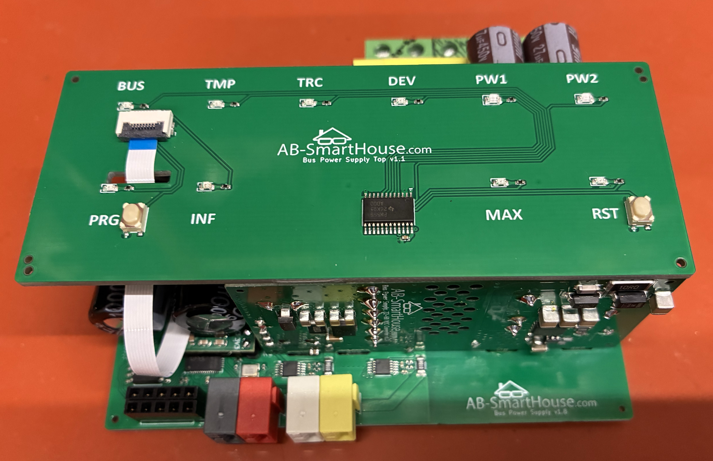 | 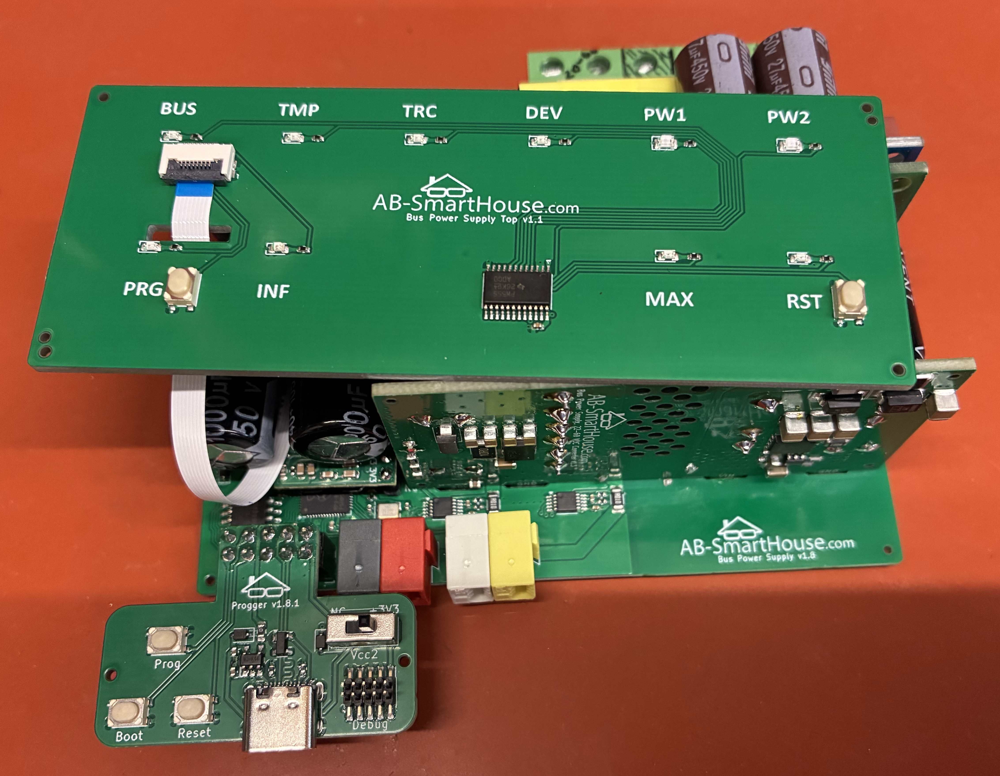 |

#### Arbeitsschritte:
1. **FFC-Kabel anschließen:** Das Flachbandkabel durch den Längsschlitz der Top-Platine führen und in den oberen ZIF-Steckverbinder einführen und verriegeln.
2. **Top-Board aufsetzen:** Die Bedienerplatine waagerecht auf die Kanten der beiden vertikal stehenden Netzteilmodule auflegen und mechanisch/elektrisch fixieren.
3. **Funktionstest & Flashen:**
   * Der modulare `Progger v1.8.1` wird auf die herausgeführte 2x5 Buchsenleiste gesteckt.
   * Verbindung über USB-C zum PC herstellen.
   * Firmware über die **OpenKNX Toolbox** kompilieren und auf den RP2040 flashen.

#### LED-Bedeutung der Frontblende:
* **BUS (Grün/Rot):** Busspannung vorhanden und innerhalb der Spezifikation (Grün) / Busunterspannung bzw. Kurzschluss (Rot).
* **TMP (Rot):** Übertemperatur-Warnung der Netzteile bzw. Endstufen.
* **TRC (Gelb/Blau):** KNX-Telegramm-Trace (blinkt bei jedem empfangenen/gesendeten Bus-Telegramm).
* **DEV (Grün):** Heartbeat / Betriebszustand des RP2040-Controllers.
* **PW1 (Grün):** Netzteilmodul 1 aktiv und liefert Sollspannung.
* **PW2 (Grün):** Netzteilmodul 2 aktiv und liefert Sollspannung.
* **INF (Gelb):** Parametrierbare Diagnose-/Info-Anzeige aus der ETS.
* **MAX (Rot):** Überlastwarnung ($I > 1280\text{ mA}$).
* **PRG (Rot):** KNX-Programmier-LED (leuchtet bei aktivem Programmiermodus).
* **RST (Rot/Gelb):** Signalisiert aktiven Bus-Reset.

---

### Zusammenbau des Gehäuses

Nach erfolgreicher Funktionsprüfung wird das Gerät in das 6-TE-Hutschienengehäuse eingebaut.

| Frontalansicht montiertes Gehäuse | Oberseite mit Klemmenbeschriftung |
| :---: | :---: |
| 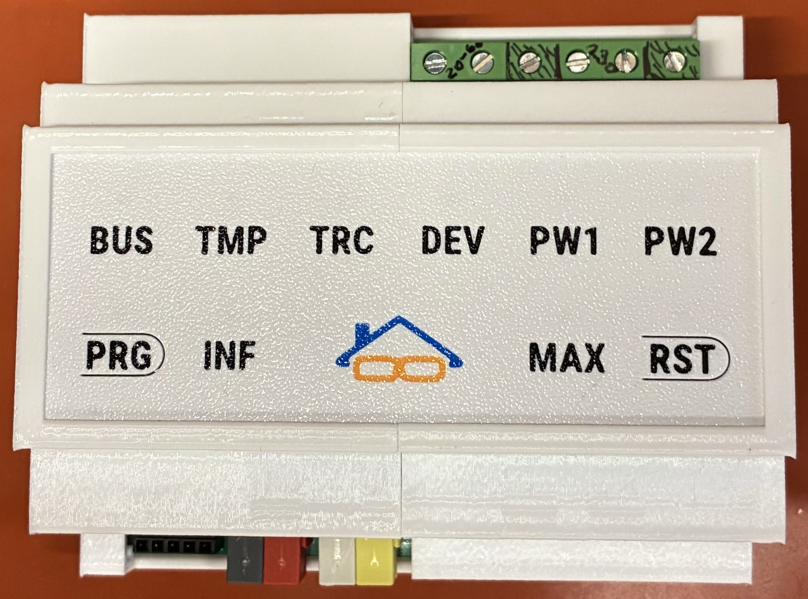 | 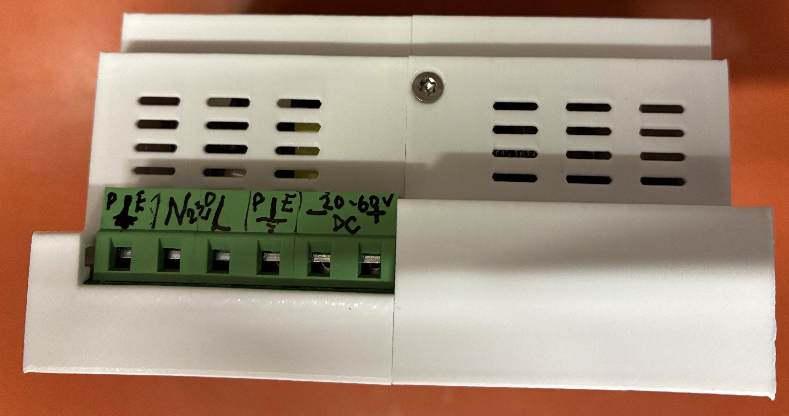 |

#### Montageablauf:
1. Die Platinenbaugruppe in die Führungsnuten der unteren Gehäusehälfte einschieben.
2. Die obere Gehäusehälfte aufsetzen, sodass die Lüftungsschlitze sauber über den Netzteilen liegen und die Rastnasen einrasten.
3. Die Frontblende passgenau in die Frontaussparung einlegen.
4. Mit den 4 M3-Senkkopfschrauben die Frontblende fest mit den Gehäusedomen verschrauben.
5. **Klemmenbeschriftung anbringen:** Die Schraubklemmen für Netz- und DC-Zuleitung dauerhaft und eindeutig beschriften (z. B. `PE`, `N 230V`, `L`, `PE`, `– 20-60V DC`, `+`).

| Frontblende Detailansicht | Unterseite mit KNX- und AUX-Buchsen |
| :---: | :---: |
| 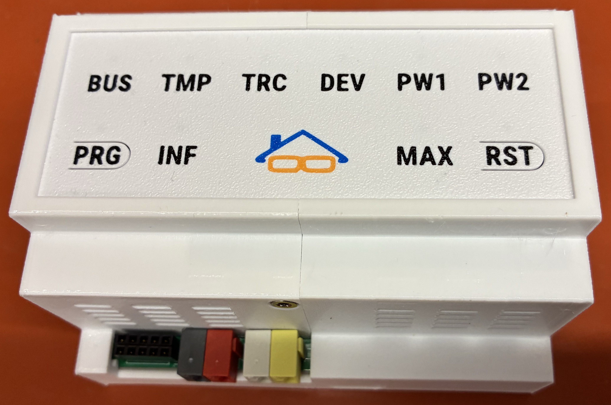 | 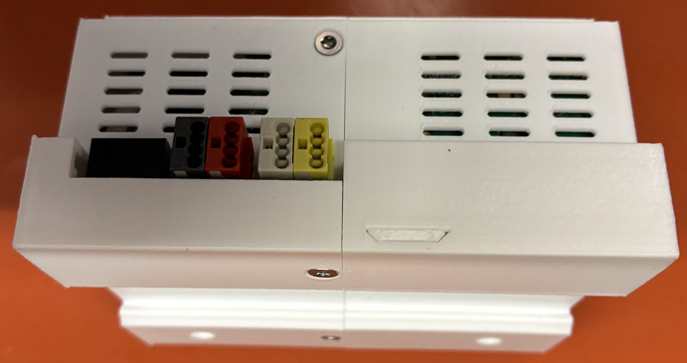 |

---

## 3. Inbetriebnahme & ETS-Parametrierung

1. **Erstinbetriebnahme am Prüfplatz:**
   * Vor dem Einbau in die Hausverteilung das Gerät am Labor-Netzgerät oder einer abgesicherten Prüfsteckdose in Betrieb nehmen.
   * Spannungen an den Klemmen messen:
     * KNX-Ausgang (rot/schwarz): 29,5 V bis 30,5 V DC.
     * AUX-Ausgang (weiß/gelb): 29,5 V bis 30,5 V DC.
2. **Firmware & OpenKNX:**
   * In der OpenKNX Toolbox das Modul `OAM-BusPowerSupply` auswählen und auf den RP2040 flashen.
3. **ETS-Einbindung:**
   * Gerätedatei (`knxprod`) in die ETS importieren.
   * Physikalische Adresse über die Taste `PRG` programmieren.
   * Diagnoseobjekte (Busspannung, Busstrom, Netzteilstatus, Reset-Auslöser) mit Gruppenadressen verknüpfen.
